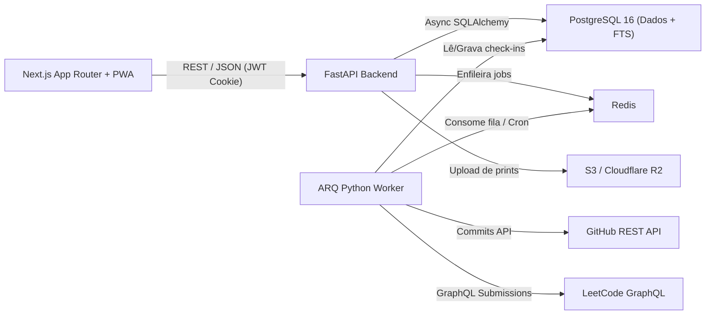
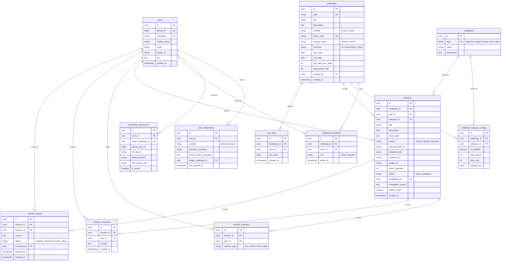

# BrainRats — Arquitetura e Modelagem de Dados (MVP)

## 1. Visão Geral da Arquitetura

O BrainRats segue uma arquitetura desacoplada com contrato tipado via OpenAPI:

### Princípios Arquiteturais
- **Separação de responsabilidades:** API REST síncrona/async em FastAPI para experiência do usuário; *workers* ARQ separados para polling/webhooks do GitHub e LeetCode.
- **Timezone por desafio:** todos os timestamps são persistidos em UTC (`timestamptz`), mas o `study_date` (`DATE`) de cada check-in é computado no `timezone` do desafio no momento da publicação.
- **Idempotência nas integrações:** eventos externos (SHA de commit do GitHub ou ID de submissão do LeetCode) são deduplicados via índice único `(user_id, source, external_event_id)`.

---

## 2. Modelagem de Dados (DER — PostgreSQL)

### Índices e Restrições Críticas
1. **Idempotência de Integrações:**
   `CREATE UNIQUE INDEX uq_checkins_external_event ON checkins (user_id, source, external_event_id) WHERE external_event_id IS NOT NULL;`
2. **Feed do Desafio (paginação por cursor):**
   `CREATE INDEX ix_checkins_challenge_feed ON checkins (challenge_id, created_at DESC) WHERE status = 'valid';`
3. **Cálculo Rápido de Teto Diário e Ranking:**
   `CREATE INDEX ix_checkins_daily_points ON checkins (challenge_id, user_id, study_date) WHERE status = 'valid';`
4. **Busca Full-Text do Diário ("Meu Diário"):**
   Coluna `search_vector` (`tsvector` gerada automaticamente a partir de `title` + `description` com dicionário `portuguese`) indexada com `GIN`:
   `CREATE INDEX ix_checkins_search_fts ON checkins USING GIN (search_vector);`
5. **Unicidade de Membro / Rest Day / Reação:**
   - `UNIQUE (challenge_id, user_id)` em `challenge_members`
   - `UNIQUE (challenge_id, user_id, rest_date)` em `rest_days`
   - `UNIQUE (checkin_id, user_id, reaction_type)` em `checkin_reactions`

---

## 3. Regras do Motor de Pontuação e Streak

### 3.1 Cálculo de `points_awarded` ao criar um check-in
Dado um desafio `C`, usuário `U`, categoria `K` e instante UTC `now`:
1. Converter `now` para o fuso `C.timezone` obtendo `study_date`.
2. Validar que `study_date` está entre `C.start_date` e `C.end_date` (se houver fim).
3. Verificar se `K` está habilitada em `challenge_category_configs`.
4. **Se `C.scoring_mode == 'checkin'`:**
   - Verificar quantos check-ins válidos `U` já possui em `(C, study_date)`.
   - Se for o primeiro check-in válido do dia: `points_awarded = 1`.
   - Caso contrário: `points_awarded = 0` (o check-in ainda é publicado no feed e salvo no diário, mas não soma ponto extra no dia).
5. **Se `C.scoring_mode == 'points'`:**
   - Calcular `raw_points` conforme os pesos configurados da categoria `K` e metadados do check-in (ex: LeetCode `Hard` = 35 pts, Leitura `20 páginas` = 20 pts).
   - Aplicar teto da categoria no dia: `cat_remaining = max(0, K_config.daily_cap - sum_points_cat_today)`.
   - Aplicar teto global do desafio no dia: `global_remaining = max(0, C.daily_points_cap - sum_points_global_today)`.
   - `points_awarded = min(raw_points, cat_remaining, global_remaining)`.

> **Recálculo na Invalidação:** Se o admin do grupo invalidar um check-in denunciado (`status = 'invalidated'`), `points_awarded` deixa de contar nas agregações de ranking/teto (e o sistema pode reavaliar se outro check-in do mesmo dia no modo `checkin` assume o ponto do dia).

### 3.2 Cálculo de Streak e Rest Days
- Percorrer os dias de `study_date` em ordem decrescente a partir de `today` (no `C.timezone`):
  - Dia tem `>= 1` check-in válido → incrementa `streak` (+1).
  - Dia não tem check-in válido, mas existe registro em `rest_days` para `(C, U, date)` → **mantém o streak** (não incrementa nem zera).
  - Dia sem check-in e sem *rest day* (exceto `today` se o dia ainda não terminou) → encerra a contagem do streak atual.
- Ao marcar um *Rest Day*, o backend valida que naquela semana ISO (segunda a domingo no `C.timezone`) o usuário usou menos que `C.rest_days_per_week`.

---

## 4. Contrato da API REST (`/api/v1`)

| Domínio | Método & Rota | Descrição |
| :--- | :--- | :--- |
| **Health** | `GET /api/v1/health` | Status da API e conectividade (DB/Redis) |
| **Auth** | `GET /api/v1/auth/github/login` | Inicia OAuth com GitHub |
| | `GET /api/v1/auth/github/callback` | Troca code por token, cria/atualiza usuário, seta JWT cookie |
| | `GET /api/v1/auth/me` | Retorna usuário autenticado |
| **Integrações** | `GET /api/v1/integrations/github/repos` | Lista repositórios do usuário no GitHub |
| | `PUT /api/v1/integrations/github/repos` | Seleciona repositórios monitorados + desafio alvo |
| | `PUT /api/v1/integrations/leetcode` | Vincula username do LeetCode + desafio alvo |
| | `POST /api/v1/integrations/sync` | Dispara sincronização manual imediata (enfileira job ARQ) |
| **Categorias** | `GET /api/v1/categories` | Lista as 5 categorias padrão e metadados suportados |
| **Desafios** | `POST /api/v1/challenges` | Cria desafio (privado/público, `checkin`/`points`, timezone, pesos) |
| | `GET /api/v1/challenges` | Lista desafios do usuário e desafios públicos abertos |
| | `GET /api/v1/challenges/{id}` | Detalhes, regras e configuração de categorias do desafio |
| | `POST /api/v1/challenges/join` | Entra via `invite_code` (privado) ou `challenge_id` (público) |
| | `GET /api/v1/challenges/{id}/leaderboard` | Ranking por pontos, streak atual ou dias ativos |
| | `POST /api/v1/challenges/{id}/rest-days` | Registra um *Rest Day* dentro da cota semanal |
| **Check-ins & Feed** | `POST /api/v1/challenges/{id}/checkins` | Cria check-in manual (título + descrição livre + metadados) |
| | `GET /api/v1/challenges/{id}/feed` | Feed paginado por cursor do desafio |
| | `PATCH /api/v1/checkins/{id}` | Edita título/descrição livre do próprio check-in |
| **Diário** | `GET /api/v1/diary` | Busca *full-text* (`q`), filtros por categoria, desafio e período |
| **Social & Moderação** | `POST /api/v1/checkins/{id}/reactions` | Toggle de reação (`fire`, `rocket`, `brain`, `clap`) |
| | `POST /api/v1/checkins/{id}/comments` | Adiciona comentário |
| | `POST /api/v1/checkins/{id}/reports` | Denuncia check-in suspeito |
| | `GET /api/v1/challenges/{id}/reports` | Lista denúncias pendentes (apenas Admin do grupo) |
| | `POST /api/v1/reports/{id}/resolve` | Admin mantém ou invalida check-in |

---

## 5. Fluxo de Sincronização Assíncrona (ARQ Worker)

1. **Scheduler (a cada 15 min) ou Botão "Sincronizar agora":**
   - **GitHub:** consulta `GET /repos/{owner}/{repo}/commits?author={username}&since={last_synced_at}` usando o token criptografado do usuário. Para cada novo commit (ignorando *merge commits* triviais se configurado):
     - Gera `external_event_id = sha`.
     - Publica automaticamente check-in na categoria `project` no `target_challenge_id` com `title = first_line(commit.message)` e `evidence_url = commit.html_url`.
   - **LeetCode:** consulta API GraphQL pública `recentAcSubmissionList(username, limit: 15)` e detalhes de dificuldade do problema (`question(titleSlug)`). Para cada submissão *Accepted*:
     - Gera `external_event_id = submission_id`.
     - Publica automaticamente check-in na categoria `leetcode` no `target_challenge_id` com `title = problem_title` e `metadata_json = {"difficulty": ..., "lang": ...}`.
2. **Deduplicação:** se `INSERT` colidir com `uq_checkins_external_event`, o evento é ignorado de forma idempotente.
